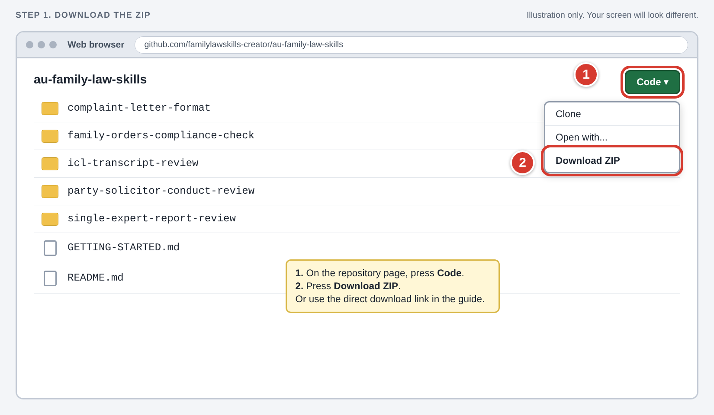
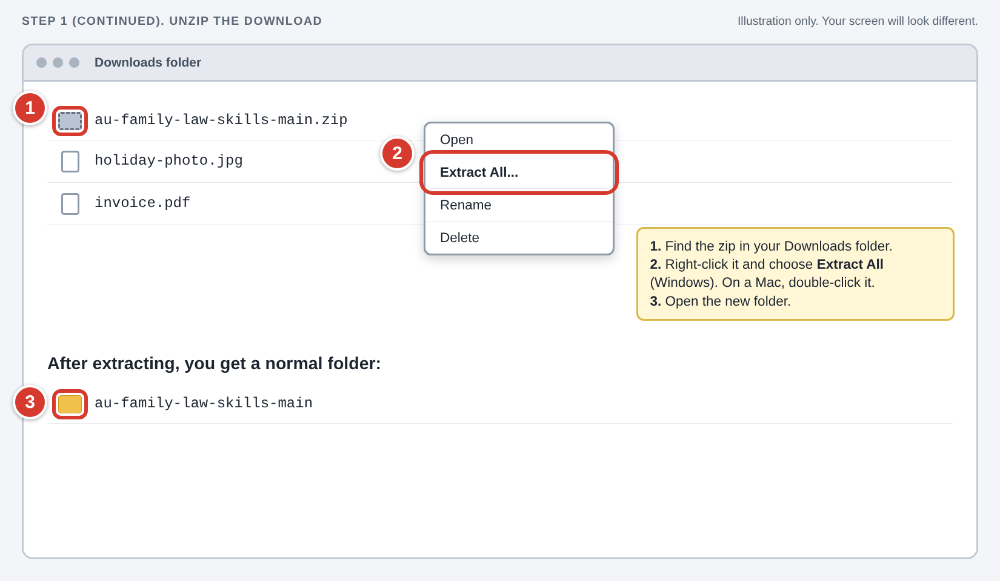
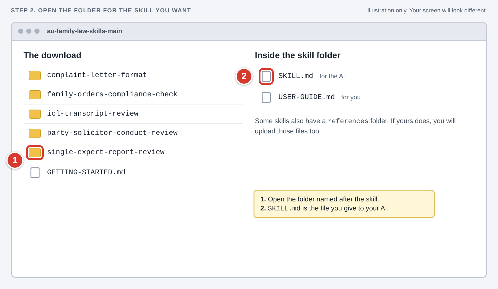
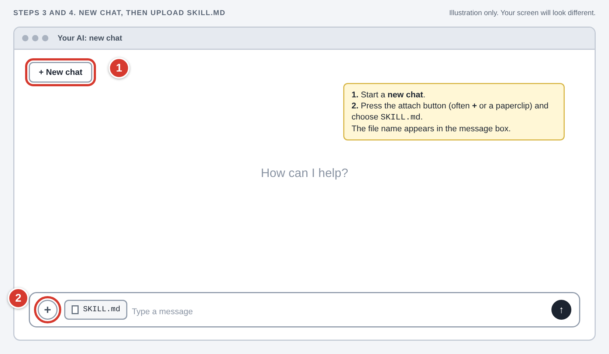
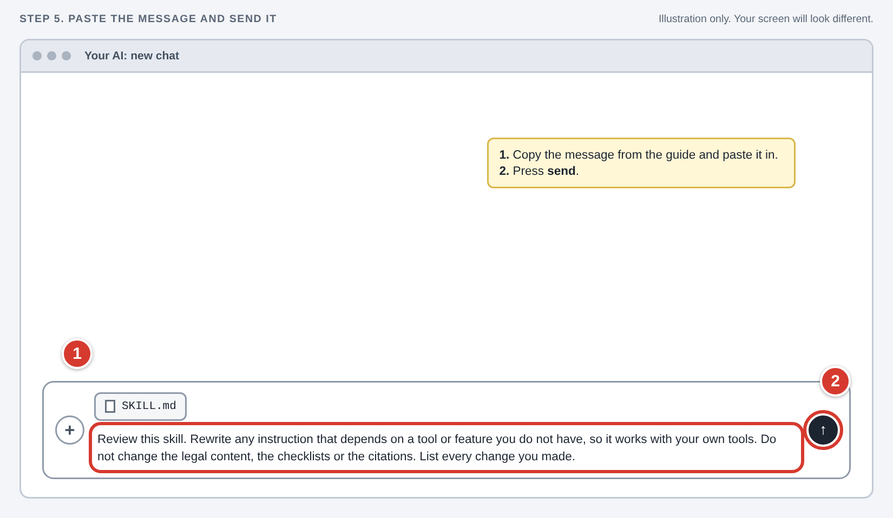
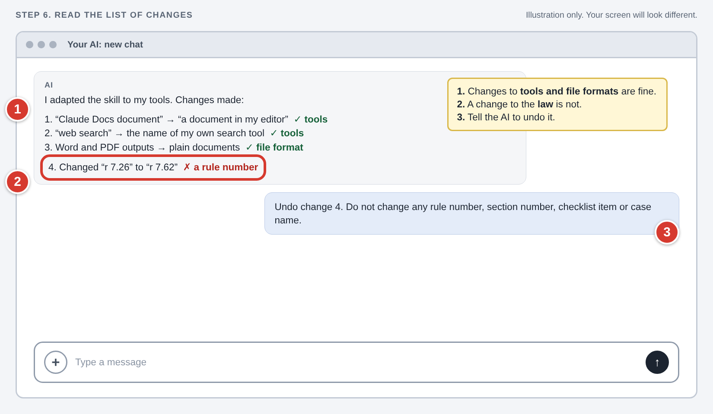
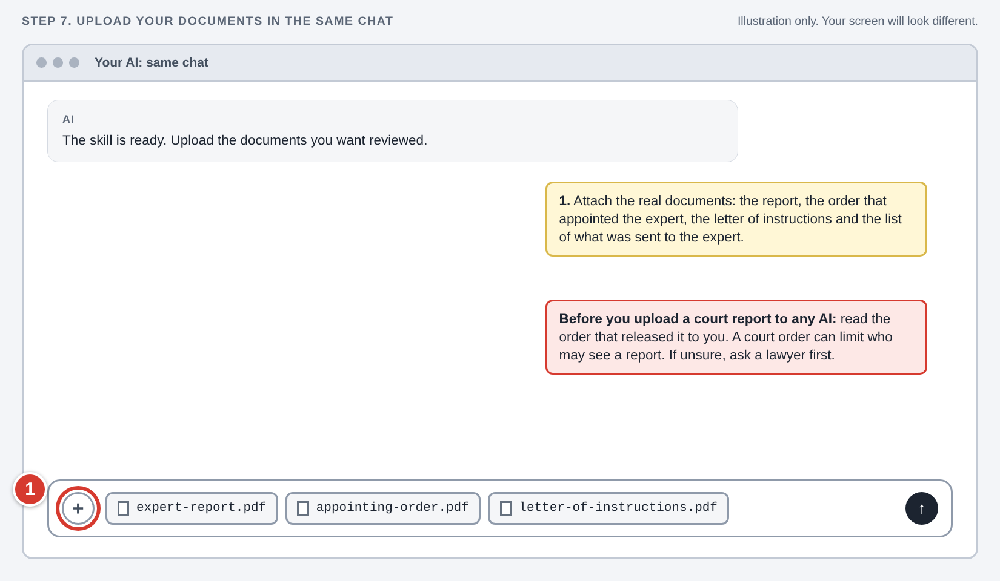
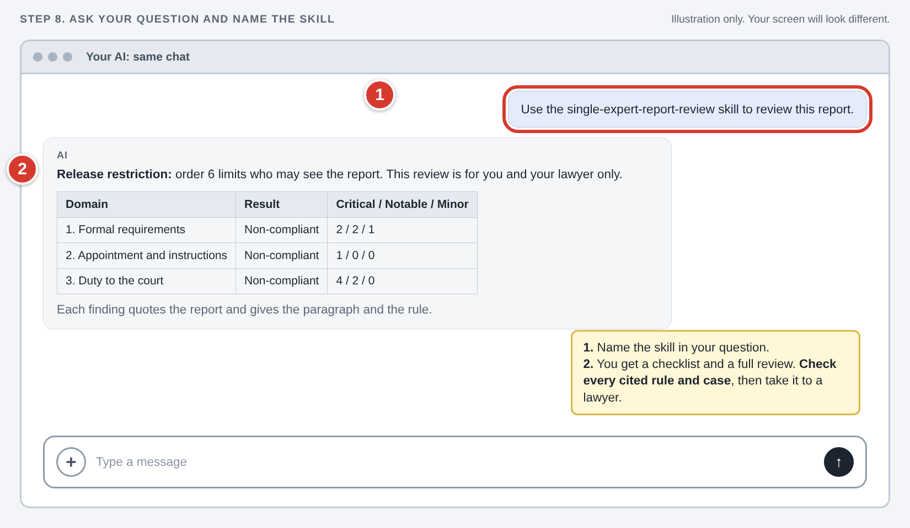
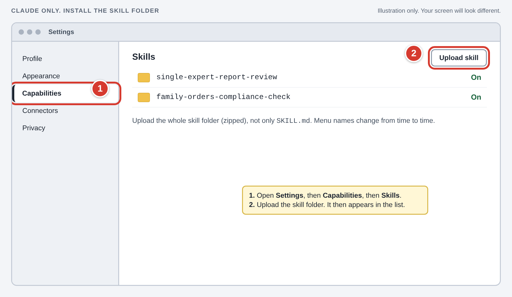
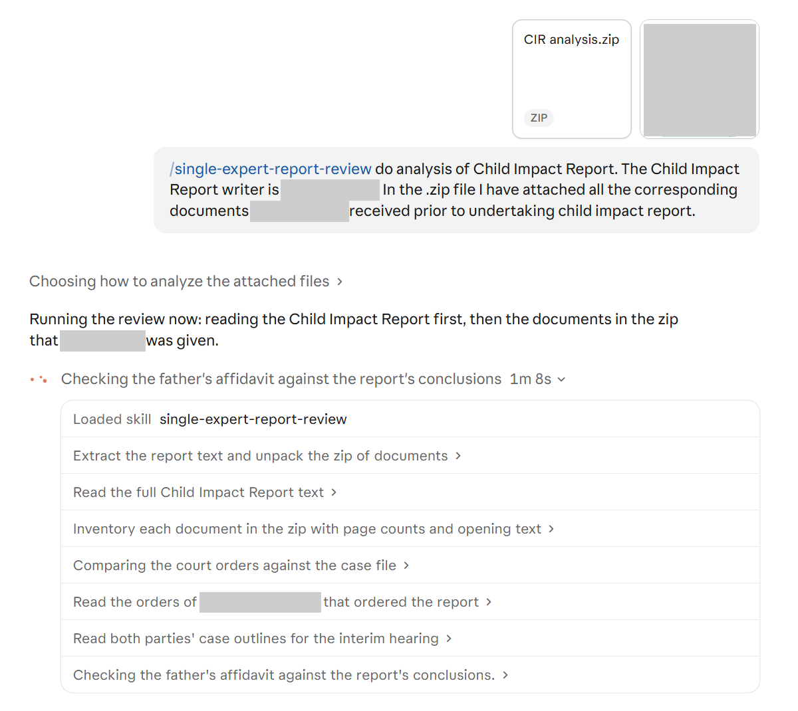

# User manual: step by step, with pictures

This manual shows each step of [Getting started](GETTING-STARTED.md) with a picture.

**About the pictures.** They are simple illustrations, not photos of a real screen. Every AI tool looks different and changes often, so your screen will not match exactly. Look for the same kind of button in the same kind of place.

- Using **ChatGPT, Gemini, Grok or another AI**? Follow Part A.
- Using **Claude**? Do steps 1 and 2 of Part A, then go to Part B.

Before you start, read [DISCLAIMER.md](DISCLAIMER.md). These skills are a review tool. They are not legal advice.

---

## Part A. Any AI (ChatGPT, Gemini, Grok and others)

### Step 1. Download the zip

Open the [repository page](https://github.com/familylawskills-creator/au-family-law-skills). Press **Code**, then **Download ZIP**. Or skip the buttons and use this [direct download link](https://github.com/familylawskills-creator/au-family-law-skills/archive/refs/heads/main.zip).

Then unzip it. On Windows, right-click the zip and choose **Extract All**. On a Mac, double-click it.

### Step 2. Open the folder for the skill you want

Each skill has its own folder. Inside it, `SKILL.md` is the file for the AI and `USER-GUIDE.md` is the file for you.

| I want to... | Open this folder |
|---|---|
| Check whether someone is following court orders or a child support agreement | `family-orders-compliance-check` |
| Challenge a single expert report, Child Impact Report or Family Report | `single-expert-report-review` |
| Review the Independent Children's Lawyer | `icl-transcript-review` |
| Review a solicitor (mine, my former one or the other side's) | `party-solicitor-conduct-review` |
| Write any of the above up as a complaint | `complaint-letter-format` |

### Step 3. Start a new chat

Open your AI and start a **new chat**. Use a new chat for each skill and each matter, so the AI does not mix them up.

### Step 4. Upload SKILL.md

Press the attach button. It is often a **+** or a paperclip beside the message box. Choose `SKILL.md` from the skill folder. If the folder has a `references` folder, attach every file in it as well.

### Step 5. Paste this message and send it

> Review this skill. Rewrite any instruction that depends on a tool or feature you do not have, so it works with your own tools. Do not change the legal content, the checklists or the citations. List every change you made.

### Step 6. Read the list of changes

The AI replies with a list of what it changed.

- **Fine:** changes about tools and file formats, for example swapping one document tool for another.
- **Not fine:** a change to a rule number, a section number, a checklist item or a case name. Tell the AI to undo it.

The changed rule number in the picture is a made-up example of what to look for.

### Step 7. Upload your documents in the same chat

Attach the real documents. The skills cite page and paragraph numbers, so they need the documents themselves, not your summary of them.

**Before you upload a court report to any AI:** read the order that released the report to you. A court order can limit who may see a report. If it does, or you are not sure, ask a lawyer before uploading it anywhere.

### Step 8. Ask your question and name the skill

For example:

> Use the single-expert-report-review skill to review this report.

Ask one narrow question: one report, one event or one statement at a time.

---

## Part B. Claude

Claude can install a skill, so you do not need steps 3 to 6.

### Step 1. Download and unzip

Same as Part A, steps 1 and 2.

### Step 2. Install the skill folder

Open **Settings**, then **Capabilities**, then **Skills**, and upload the skill folder. Menu names change from time to time. If you cannot find it, check Claude's help centre.

### Step 3. Start a new chat and name the skill

Attach your documents and name the skill. You can type `/` followed by the skill name, as in the picture, or just name it in your sentence. Claude also loads a skill on its own when your request matches it.

This one is a real screenshot of the skill reviewing a Child Impact Report. The names, the date and the report itself are covered. You can see Claude load the skill, read the report in full, list the documents it was given, and then compare them.

---

## After you get a result

1. **Check it.** Open every section, rule and case the AI cites and read it yourself. AI tools make mistakes and can sound sure when they are wrong.
2. **Fill the gaps.** Where the result says "Not assessable", find the missing document and ask again.
3. **Keep it private.** Section 114Q of the Family Law Act 1975 (Cth) makes it an offence to publish identifying details of family law proceedings.
4. **Take it to a lawyer** before you file, complain or act on it.

## If something goes wrong

| Problem | Try this |
|---|---|
| The AI summarises the skill and does not run it | Say: "Follow the skill step by step and produce every output it lists." |
| The AI says the file is too long | Upload `SKILL.md` first and send the step 5 message. Upload your documents after it replies. |
| The AI forgets the skill part way through | Start a new chat and begin again from step 4. Keep one skill and one matter per chat. |
| The AI cites a case or section the skill does not mention | Ask for the link to the source. If it cannot give one, do not rely on it. |
| The AI cannot read a scanned document | Ask it what it can read. A text PDF works better than a photo of a page. |

Free help: LawAccess NSW (1300 888 529), Legal Aid in your state, or a community legal centre.
